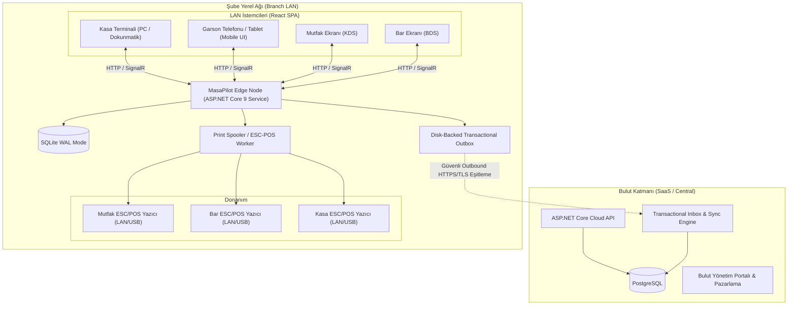

# MasaPilot — Mimari Tasarım Belgesi (docs/ARCHITECTURE.md)

## 1. Genel Bakış ve Hedefler

MasaPilot; restoran, kafe ve bar işletmeleri için geliştirilmiş, çok kiracılı (multi-tenant) SaaS mimarisini şube düzeyinde yerel çalışma yeteneği (Edge Node) ile birleştiren bir adisyon ve restoran otomasyon platformudur.

Platformun temel mimari prensibi: **"İnternet (WAN) kopsa dahi yerel ağ (LAN) çalıştığı sürece kasa, garson ve mutfak operasyonu kesintisiz devam etmelidir."**



---

## 2. Mimari Karar Kayıtları (ADR)

### ADR-01: Modüler Monolit & Çift Modlu Dağıtım (Edge & Cloud)
- **Karar:** Uygulama çekirdeği (Domain, Application, Core Services) tek bir C# (.NET 9) kod tabanında geliştirilir.
- **Modlar:**
  - `RuntimeMode=Edge`: Şube yerelinde çalışır. Yerel SQLite (WAL modu, busy timeout = 5000ms) kullanır. Tüm operasyonel yazmalar yerelde kesinleşir (authoritative source). Outbox kuyruğu aracılığıyla olayları buluta iletir.
  - `RuntimeMode=Cloud`: Merkezi sunucuda çalışır. PostgreSQL kullanır. Tenant yönetimi, global raporlama ve şubeler arası veri konsolidasyonunu yönetir.
- **Gerekçe:** Domain kurallarının ve iş mantığının (fiyat hesaplama, vergi, adisyon kapatma) iki ayrı kod tabanında çoğaltılmasını engeller.

### ADR-02: Yerel Veritabanı ve Eşzamanlılık (SQLite WAL Modu)
- **Karar:** Edge modunda SQLite, Write-Ahead Logging (`PRAGMA journal_mode=WAL`) ve `PRAGMA synchronous=NORMAL` ile çalıştırılır. Yazma işlemleri EF Core DbContext üzerinden ACID transaction'lar ile izole edilir.
- **Kısıt:** Cihazlar doğrudan SQLite dosyasına dosya paylaşımı üzerinden erişmez; tüm okuma ve yazmalar yerel ASP.NET Core REST API ve SignalR hub'ları üzerinden yönlendirilir.

### ADR-03: Fiyat ve Para Temsili
- **Karar:** Tüm para tutarları (birim fiyat, ara toplam, vergi, indirim, tahsilat) `decimal(18,2)` hassasiyetiyle temsil edilir. Asla kayan noktalı sayı (`float`, `double`) kullanılmaz.
- **Snapshot Prensibi:** Sipariş satırı (`OrderLine`) kaydedildiği anda ürünün o anki adı, birim fiyatı, KDV oranı ve indirim tutarı satıra kopyalanır (`UnitPriceSnapshot`, `VatRateSnapshot`). Ürün kataloğundaki sonraki fiyat değişiklikleri geçmiş adisyonları etkilemez.

### ADR-04: Masa ve Menü Akışının Ayrılması
- **Karar:** POS ekranında **önce açık bir masa veya paket sipariş seçilmelidir**. Masa seçimi yapılmadan ürün kataloğuna sipariş amacıyla doğrudan giriş yapılamaz.
- **Masa Kuralı:** Bir masada aynı anda yalnızca **tek bir açık oturum (`TableSession`)** bulunabilir. Bu kural veritabanı seviyesinde filtrelenmiş benzersiz indeks (`UNIQUE(BranchId, DiningTableId) WHERE Status = 'Open'`) ve transaction seviyesinde kilit ile garanti edilir.

### ADR-05: Transactional Outbox / Inbox ile Eşitleme
- **Karar:** İnternet kesintisi durumunda yerel operasyon durmaz. Sipariş, ödeme, iptal gibi her durum değişikliği yerel DB transaction'ı içinde `OutboxEvent` olarak kalıcı kaydedilir.
- **Eşitleme:** Ağ tekrar bağlandığında `SyncWorker` olayları sırayla bulut Inbox'ına gönderir. Her olayın tekil `EventId` (UUID) ve `IdempotencyKey` değeri bulunur; bulut mükerrer olayları işleme almaz.

### ADR-06: Yazdırma Güvenilirliği (Print Spooler)
- **Karar:** Yazdırma işlemi veritabanı transaction'ı içinde bloklayıcı ağ çağrısı olarak yapılmaz. DB transaction'ında `PrintJob` kaydı oluşturulur; arka plan `PrintWorker` servisi işi talep eder (`claimed`), ESC/POS komutlarını iletir ve sonucu (`printed`, `retryable_failed`, `manual_review`) günceller.
- **Baskı Belirsizliği:** Yazıcı zaman aşımına uğradığında veya fiziksel kağıt durumu bilinmediğinde sistem otomatik olarak ikinci kez fiş basmaz. Arayüzde "Baskı durumu belirsiz - Kontrol et ve tekrar bas" uyarısı çıkar. Tekrar basılan fişlerde kalın `*** TEKRAR BASKI ***` damgası bulunur.

### ADR-07: Gerçek Zamanlı LAN İletişimi (SignalR)
- **Karar:** Masa durumu değişiklikleri, yeni siparişler ve mutfak hazır bildirimleri ASP.NET Core SignalR ile yayınlanır. Her bağlantı `TenantId_BranchId` grubuna dahil edilir. Gruplar arası veri sızıntısı yetkilendirme katmanında engellenir.
- **Yedek Mekanizma:** WebSocket kurulamayan kısıtlı ortamlarda kontrollü aralıklı polling fallback'i devreye girer.

---

## 3. Katmanlı Çözüm Yapısı

```
MasaPilot/
├── src/
│   ├── MasaPilot.Domain/            # Saf C# Domain Entity, Value Objects, Enums, Interfaces
│   ├── MasaPilot.Application/       # Servisler, DTO'lar, Kurallar, Validasyonlar
│   ├── MasaPilot.Infrastructure/    # EF Core (SQLite & Postgres), Outbox, PrintWorker, Auth
│   ├── MasaPilot.Api/               # ASP.NET Core Web API, SignalR Hubs, Middleware
│   └── MasaPilot.Web/               # React 19 + TypeScript + Vite + Tailwind CSS SPA
├── tests/
│   └── MasaPilot.Tests/             # xUnit Unit & Integration & Isolation Tests
├── scripts/                         # Windows kurulum, başlatma, yedekleme betikleri
└── docs/                            # Teknik dokümantasyon ve işletim kılavuzları
```
