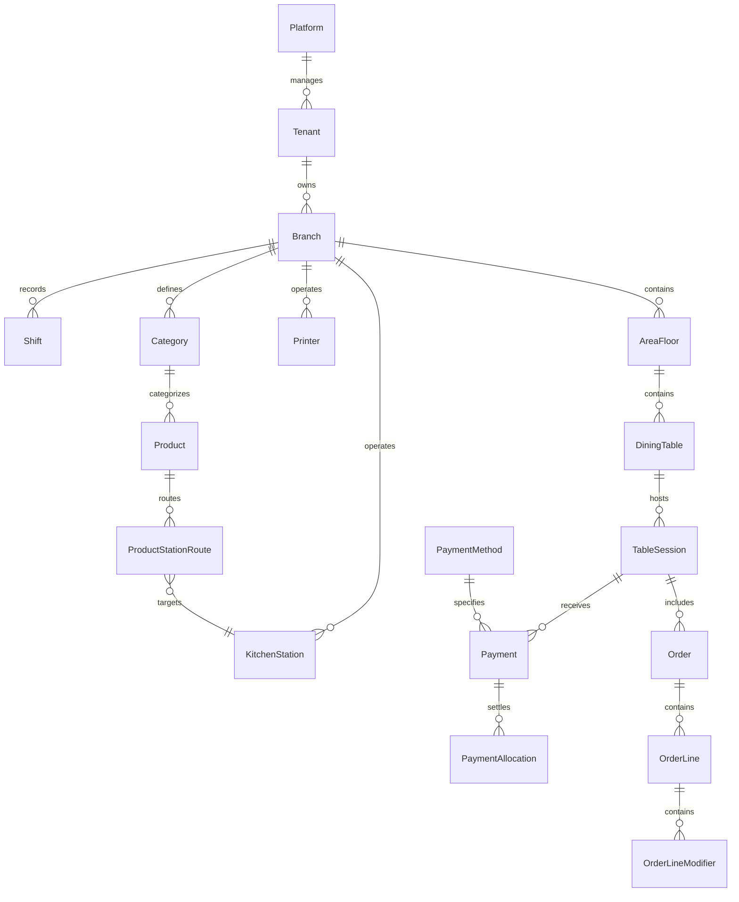

# MasaPilot — Veri Modeli ve Bütünlük Kuralları (docs/DATA_MODEL.md)

## 1. Veri Hiyerarşisi

---

## 2. Temel Varlıklar ve Alan Tanımları

### 2.1 Çok Kiracılı Yapı & Güvenlik
- **Tenant:** `Id (Guid)`, `Name`, `Slug`, `TaxNumber`, `IsActive`, `CreatedAtUtc`
- **Branch:** `Id (Guid)`, `TenantId (Guid, FK)`, `Name`, `Address`, `Phone`, `CurrencyCode (default 'TRY')`, `TimeZone (default 'Europe/Istanbul')`, `IsActive`
- **User:** `Id (Guid)`, `TenantId (Guid, FK)`, `Email`, `FullName`, `PasswordHash`, `PinCodeHash` (hızlı garson girişi için güvenli hash), `IsActive`
- **Role:** `PlatformAdmin`, `TenantOwner`, `BranchManager`, `Cashier`, `Waiter`, `KitchenStaff`
- **UserBranchRole:** `UserId`, `BranchId`, `RoleId`

### 2.2 Salon, Masa ve Adisyon (Session)
- **AreaFloor:** `Id (Guid)`, `TenantId`, `BranchId`, `Name` (örn. Salon, Teras, Bahçe), `DisplayOrder`
- **DiningTable:** `Id (Guid)`, `TenantId`, `BranchId`, `AreaFloorId (FK)`, `TableNumber` (örn. "S-1", "B-4"), `Capacity`, `Status` (`Empty`, `Occupied`, `BillRequested`, `Reserved`)
- **TableSession:** 
  - `Id (Guid)`, `TenantId`, `BranchId`, `DiningTableId (FK, nullable for takeout)`, `SessionNumber` (günlük artan okunabilir kod), `OpenedByUserId`, `OpenedAtUtc`, `ClosedAtUtc`, `Status` (`Open`, `Closed`, `Merged`, `Cancelled`), `Notes`
  - **Kritik Kısıt:** `UNIQUE(BranchId, DiningTableId)` koşulu `WHERE Status = 'Open'`. Bir masada aynı anda yalnızca 1 açık adisyon bulunabilir.
  - **Finansal Özet Alanları (Server-computed):** `SubTotal (decimal)`, `TaxTotal (decimal)`, `DiscountTotal (decimal)`, `GrandTotal (decimal)`, `PaidTotal (decimal)`, `RemainingTotal (decimal)`

### 2.3 Ürün Kataloğu, Varyant ve İstasyon Rotaları
- **Category:** `Id (Guid)`, `TenantId`, `BranchId`, `Name`, `DisplayOrder`, `ColorHex`, `IsActive`
- **Product:** `Id (Guid)`, `TenantId`, `BranchId`, `CategoryId (FK)`, `Name`, `Description`, `Sku`, `Barcode`, `UnitPrice (decimal 18,2)`, `VatRate (decimal 4,2)`, `ImageUrl`, `IsActive`, `IsAvailable` (stokta var/yok)
- **ModifierGroup:** `Id (Guid)`, `TenantId`, `BranchId`, `Name` (örn. Pişirme Derecesi, Ekstra Sos, Süt Tercihi), `MinSelect`, `MaxSelect`, `IsRequired`
- **ModifierOption:** `Id (Guid)`, `ModifierGroupId (FK)`, `Name`, `ExtraPrice (decimal 18,2)`
- **KitchenStation:** `Id (Guid)`, `TenantId`, `BranchId`, `Name` (örn. Mutfak, Bar, Fırın, Soğuk Meze), `IsActive`
- **ProductStationRoute:** `ProductId (FK)`, `KitchenStationId (FK)` (Her ürünün sipariş verildiğinde hangi ekrana ve hangi yazıcıya düşeceğini belirler)

### 2.4 Sipariş ve Satır Snapshot Modeli
- **Order:** `Id (Guid)`, `TenantId`, `BranchId`, `TableSessionId (FK)`, `OrderNumber`, `CreatedByUserId`, `CreatedAtUtc`, `Status` (`Submitted`, `Preparing`, `Ready`, `Delivered`, `Cancelled`), `IdempotencyKey`
- **OrderLine:**
  - `Id (Guid)`, `OrderId (FK)`, `ProductId (FK)`, `Quantity (decimal 8,2)`, `UnitPriceSnapshot (decimal 18,2)`, `VatRateSnapshot (decimal 4,2)`, `ProductNameSnapshot (string)`, `LineTotal (decimal 18,2)`, `LineTax (decimal 18,2)`, `Notes`, `KitchenStationId (FK)`, `Status` (`New`, `SentToKitchen`, `Preparing`, `Ready`, `Served`, `Voided`), `VoidReason`, `VoidByUserId`
- **OrderLineModifier:** `OrderLineId (FK)`, `OptionNameSnapshot`, `ExtraPriceSnapshot`

### 2.5 Tahsilat, Ödeme Türleri ve Ön Hesap
- **PaymentMethod:** `Id (Guid)`, `TenantId`, `BranchId`, `Name` (Nakit, Kredi Kartı, Sodexo, Multinet, İkram), `Type` (`Cash`, `CardExternalTerminal`, `MealVoucher`, `Custom`), `IsActive`
- **Payment:** `Id (Guid)`, `TenantId`, `BranchId`, `TableSessionId (FK)`, `PaymentMethodId (FK)`, `Amount (decimal 18,2)`, `TipAmount (decimal 18,2)`, `ProcessedByUserId`, `ProcessedAtUtc`, `IdempotencyKey`, `Status` (`Completed`, `Voided`, `Refunded`), `Notes`
- **Shift (Vardiya / Kasa):** `Id (Guid)`, `TenantId`, `BranchId`, `OpenedByUserId`, `OpenedAtUtc`, `ClosedAtUtc`, `StartingCash`, `ExpectedCash`, `ActualCash`, `Difference`

### 2.6 Yazdırma ve Kuyruk Modeli
- **Printer:** `Id (Guid)`, `TenantId`, `BranchId`, `Name`, `ConnectionType` (`NetworkEthernet`, `WindowsDriverUsb`, `VirtualFake`), `IpAddress`, `Port` (varsayılan 9100), `WindowsDriverName`, `PaperWidth` (`80mm`, `58mm`), `IsActive`
- **PrintJob:**
  - `Id (Guid)`, `TenantId`, `BranchId`, `PrinterId (FK)`, `JobType` (`KitchenTicket`, `BarTicket`, `PreReceipt`, `VoidTicket`, `TestPage`), `Title`, `RawContentEscPos (binary/text)`, `Status` (`Queued`, `Claimed`, `Printing`, `Printed`, `RetryableFailed`, `ManualReview`, `Cancelled`), `AttemptsCount`, `LastAttemptAtUtc`, `LastError`, `IsReprint` (bool, mükerrer basımlarda TEKRAR BASKI damgası için)

### 2.7 Eşitleme, Outbox ve Audit
- **OutboxEvent:** `Id (Guid)`, `TenantId`, `BranchId`, `AggregateType`, `AggregateId`, `EventType`, `PayloadJson`, `OccurredAtUtc`, `IsDispatched`, `DispatchedAtUtc`, `RetryCount`
- **InboxEvent:** `Id (Guid, tekil)`, `TenantId`, `BranchId`, `EventId`, `AggregateType`, `PayloadJson`, `ProcessedAtUtc`
- **AuditLog:** `Id (Guid)`, `TenantId`, `BranchId`, `UserId`, `Action`, `EntityName`, `EntityId`, `DetailsJson`, `IpAddress`, `CreatedAtUtc`
